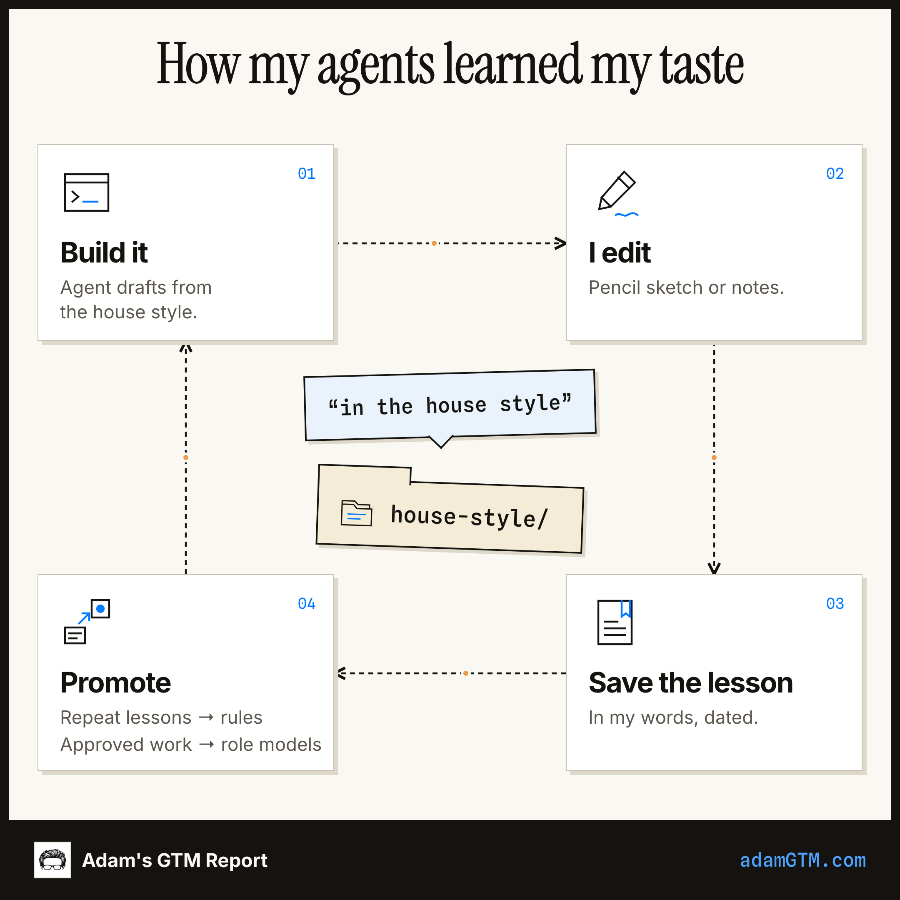
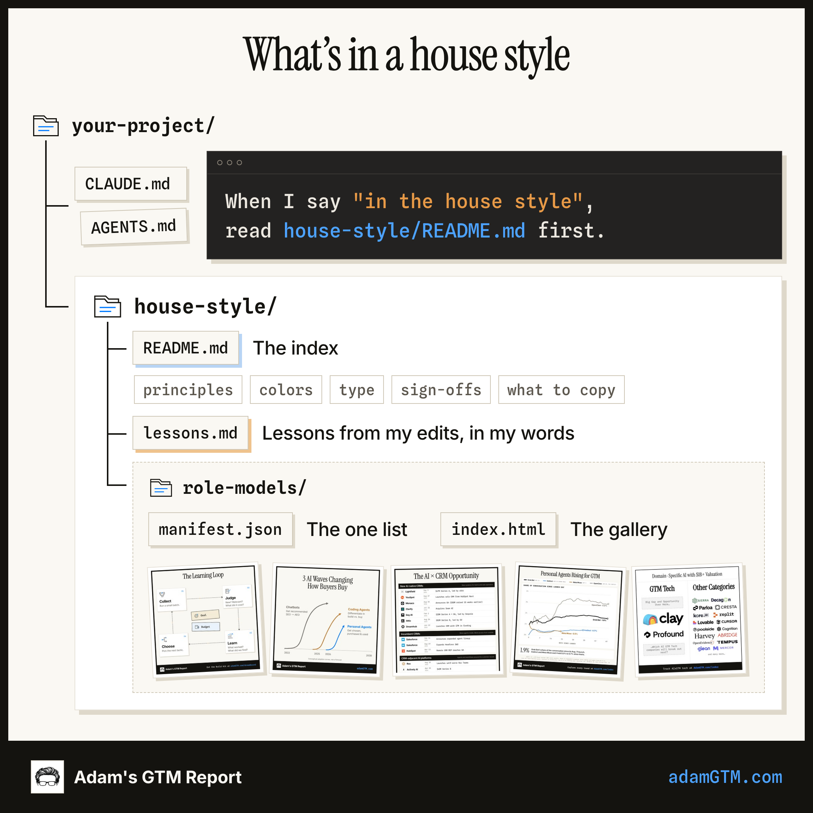
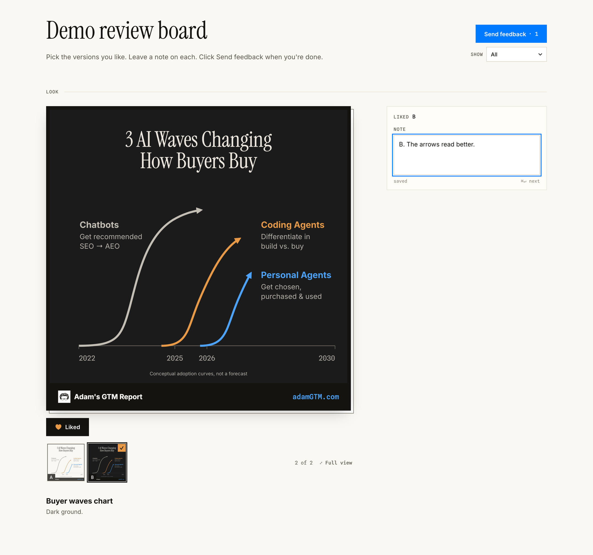

# House Style Kit

Hi, I'm Adam. I write [Adam's GTM Report](https://adamgtm.com), and I build with coding agents.

I spend a TON of time making graphics, charts, and decks. I always have. I actually enjoy it. These days it's pencil sketches + talking with coding agents, and my outputs are getting better and taking less time.

The hard part was taste. AI can make a decent chart in seconds. It also makes everyone's charts look the same. Describing my style in adjectives never worked. Showing my agents real examples did.

So I built a house style: a gallery of role models, a log of lessons from my edits, and one phrase, "in the house style," that points my agents at all of it. This kit helps you build your own, for your brand or a personal project.



## Start

You need Claude Code or Codex working locally, not a standard chat window. In Claude's desktop app, use the Code tab.

Open the project where you already work with your agent (or a new folder) and paste this:

```text
Get the House Style Kit from https://github.com/adamgtm/house-style-kit into a folder called house-style-kit here. Read house-style-kit/START-HERE.md and walk me through building my house style. Ask me one question at a time, use real examples of my work, and show me my gallery when it's built.
```

The agent will ask you a few questions, study 10 to 20 things you've made, show you what it sees, and help you pick your role models. Plan on about 30 minutes.

## What you end up with



- `house-style/README.md`: the index. Your principles, your look, where your work is seen, and the role model to copy for each kind of work.
- `house-style/lessons.md`: lessons from your edits, in your own words.
- `house-style/role-models/`: your best work, the list behind it, and a gallery page you can open in a browser.
- A few lines in your `CLAUDE.md` or `AGENTS.md`, so "in the house style" means something to every future session.

Want to see a finished gallery first? The kit includes a small example built from a few of my graphics:

```
python3 scripts/build_gallery.py --manifest examples/role-models/manifest.json --open
```

## After setup

- Ask for anything "in the house style."
- When you edit what your agent made, it saves the lesson in your words. When a lesson keeps coming back, it becomes a rule.
- When you love something, say "make this a role model."
- About once a month, paste [the contradiction audit](prompts/contradiction-audit.md). Rules drift apart over time.
- Before anyone sees a page, measure it on a phone: `python3 house-style/check_page.py page.html`. It needs [Playwright](scripts/check_page.py), a one-time install.
- When one kind of work keeps showing up in your lessons, give it [a standard](prompts/write-a-standard.md). When a lesson can be measured, [turn it into a check](prompts/turn-lessons-into-checks.md).
- When you make something every week, [turn it into a builder](prompts/make-a-builder.md). When you need many at once, [run a batch](prompts/batch-in-the-house-style.md). When a graphic needs a person, [generate one](prompts/generate-people.md). When something needs a real redesign, [do it in rounds](prompts/redesign-in-rounds.md).

## Review in rounds

When a design has real choices, I don't read options in a chat window. My agent builds a review board: one page with a stack of versions for each decision. I click through them with the keyboard, like what I like, leave a note on each, and click Send. The notes go straight back to my agent, which saves them as lessons. Try the demo: `python3 review-board/scripts/build_review_board.py examples/review/review.json --open`. [How it works](review-board/README.md).



## What I learned building mine

1. **Examples teach taste. Adjectives don't.** "Clean, editorial, a little warm" gets you the same chart as everyone else.
2. **Save the posted final.** Drafts called "done" aren't always the version that went out, and study folders get renamed. Copy the final into your role models.
3. **Write lessons in your own words, with a date.** When a new lesson disagrees with an old one, the new one wins.
4. **Give it one home and one phrase.** My rules had spread across a dozen places, and 21 of them contradicted each other. I didn't even spell my own URL the same way twice.
5. **Audit every month.** Most contradictions settle by date. The rest are real taste calls, and those are yours to make.
6. **Keep borrowed voices out.** A guest post or a sponsor's ad deviates from your style on purpose. Don't let it teach your agents.
7. **Measure it on a phone before anyone else sees it.** Most layout bugs are invisible in the code and obvious in the picture. Some don't show in a screenshot either: an invisible tooltip made 870 of my 874 brand pages wider than a phone screen. `check_page.py` measures it.
8. **Know where each platform crops.** My newsletter archive used to show only the center square of every thumbnail. Design the part that survives the crop first, then check it.
9. **When a format repeats, build it once.** My weekly lead card comes from a short spec and a builder that fails when text overflows or gets too small. No card goes out with a cut-off headline, and my time goes into what it says.
10. **Give agents a brief, a check and a fresh reviewer.** When agents rebuilt 17 of my old thumbnails, a reviewer who hadn't seen the drafters' reasoning caught what they missed: the same screenshot on two cards, and two near-identical numbers side by side.
11. **Match two properties by measuring them.** My website and my newsletter run on different platforms, and their headers never quite lined up. Measuring both and matching them to the pixel fixed it.

## No work of your own yet?

Start from 3 to 5 outside pieces you admire, and write down why. The kit marks them as borrowed, and you replace them as your own work piles up. Writers have learned this way forever by copying the masters.

## What's in this repo

| Path | What it is |
|---|---|
| `START-HERE.md` | The step-by-step guide your agent follows |
| `templates/house-style/` | The starter folder: index, lessons log, manifest |
| `templates/router.md` | The lines for your `CLAUDE.md` or `AGENTS.md` |
| `scripts/build_gallery.py` | Builds your gallery page, plus a graphic of it for posts (`--sheet`) |
| `scripts/check_page.py` | Measures a page at phone, tablet and laptop widths: what runs off the screen, and text that's too small |
| `review-board/` | The review board: scripts and page for picking and commenting on versions in rounds |
| `prompts/` | Prompts to paste: the monthly contradiction audit, adding role models from past work, writing a standard, making a builder, running a batch, generating people, turning lessons into checks and redesigning in rounds |
| `examples/` | A small working gallery and a demo review board, to show the format |
| `diagrams/` | The pictures above, light and dark, plus a review board screenshot |

## Thanks

[Kieran Flanagan's Creative Context OS](https://www.kieranflanagan.io/p/the-creative-context-os-how-to-stop) got me to audit my own setup. His three files (creator, audience, taste) are about writing. This is the visual side.

If you build one, I'd love to see it. Find me on [LinkedIn](https://www.linkedin.com/in/adamschoenfeld/) or at [adamGTM.com](https://adamgtm.com).

Adam
